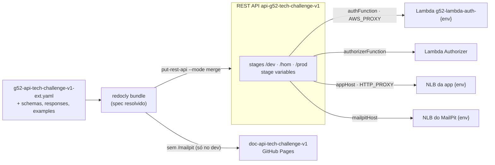

# g52-api-tech-challenge-v1-ext

Esse repo guarda o contrato OpenAPI da API do G52 | Tech Challenge, é o que vira a especificação importada no API Gateway da AWS (por isso o `-ext`, de extensions do `x-amazon-apigateway-integration`).

## Links

| | |
|---|---|
| Documentação da API (Swagger) | https://teplotax.github.io/doc-api-tech-challenge-v1/ |
| Collection Postman/Insomnia | Enviada no PDF de entrega, porque contém CPFs de teste do seed |
| Arquitetura da solução (diagramas, RFCs, ADRs) | [`g52-app-tech-challenge/docs/arquitetura`](https://github.com/Teplotax/g52-app-tech-challenge/tree/main/docs/arquitetura) |
| Pipelines | [GitHub Actions](https://github.com/Teplotax/g52-api-tech-challenge-v1-ext/actions) |

### Deploys

Todos os ambientes respondem pelo mesmo API Gateway, com um stage por ambiente:

| Ambiente | URL base | Healthcheck |
|---|---|---|
| dev | https://08onkvn4jb.execute-api.us-east-1.amazonaws.com/dev | [`/dev/health`](https://08onkvn4jb.execute-api.us-east-1.amazonaws.com/dev/health) |
| hom | https://08onkvn4jb.execute-api.us-east-1.amazonaws.com/hom | [`/hom/health`](https://08onkvn4jb.execute-api.us-east-1.amazonaws.com/hom/health) |
| prod | https://08onkvn4jb.execute-api.us-east-1.amazonaws.com/prod | [`/prod/health`](https://08onkvn4jb.execute-api.us-east-1.amazonaws.com/prod/health) |

Para economizar, os ambientes ficam desligados quando não estão em uso ([ADR-003](https://github.com/Teplotax/g52-app-tech-challenge/blob/main/docs/arquitetura/adrs/ADR-003-ambientes.md)). O healthcheck mostra se um ambiente está no ar.

## Sobre a API

API de gerenciamento de ordens de serviço para oficinas mecânicas. Permite controlar o ciclo de vida completo de uma OS, desde a abertura até a entrega do veículo, além de gerenciar clientes, veículos, peças, insumos e serviços cadastrados.

### Ciclo de vida de uma OS

| De | Para | Ação |
|----|------|------|
| `RECEBIDA` | `EM_DIAGNOSTICO` | Iniciar diagnóstico |
| `EM_DIAGNOSTICO` | `AGUARDANDO_APROVACAO` | Solicitar aprovação: envia orçamento por e-mail ao cliente |
| `AGUARDANDO_APROVACAO` | `APROVADA` | Cliente aprova o orçamento (total ou parcial) |
| `APROVADA` | `EM_EXECUCAO` | Iniciar execução dos serviços |
| `EM_EXECUCAO` | `FINALIZADA` | Finalizar execução: consome estoque real e libera reservas |
| `FINALIZADA` | `ENTREGUE` | Entregar veículo: envia nota fiscal por e-mail e limpa tagChave |
| `CANCELADA` | `DEVOLVIDO` | Devolver veículo fisicamente: limpa tagChave |
| Qualquer status até `FINALIZADA` | `CANCELADA` | Cancelar OS: libera reservas de estoque |

> `ENTREGUE` e `DEVOLVIDO` são status terminais, nenhuma transição é permitida a partir deles.

### Gestão de estoque

O estoque de peças e insumos é controlado em duas camadas:

- **Estoque reservado** (`estoqueReservado`): reservado ao adicionar serviços à OS. Liberado ao cancelar ou finalizar.
- **Estoque real** (`estoque`): consumido definitivamente apenas na finalização da OS.

Ao cancelar uma OS, o que é liberado depende do status atual: antes de `APROVADA` libera a reserva de todos os serviços, a partir de `APROVADA` libera só a dos aprovados.

### Aprovação do orçamento

Ao solicitar aprovação, o sistema muda o status pra `AGUARDANDO_APROVACAO`, gera o orçamento em PDF e manda por e-mail com um link assinado (HMAC); o cliente aprova direto por ali, sem precisar logar. A aprovação pode ser total ou parcial.

### Autenticação

O cliente se autentica pelo CPF e recebe um JWT, emitido pela Function Serverless do repositório [`g52-lambda-tech-challenge`](https://github.com/Teplotax/g52-lambda-tech-challenge):

```
POST /auth                    {"cpf": "555.632.710-64"}  -> token de cliente (roles: CLIENTE)
POST /auth/token              grant_type=client_credentials&client_id=...&client_secret=...  -> token administrativo (roles: ADMIN)
GET  /.well-known/jwks.json   chave pública para validar o JWT
```

Essas três rotas são públicas e usam integração `aws_proxy` com a Lambda `g52-lambda-auth-<ambiente>`. Todas as outras exigem `Authorization: Bearer <jwt>` e passam pelo **Lambda Authorizer** (`g52-lambda-auth-authorizer`, tipo TOKEN, com cache de 5 min):

- Sem token, ou com token inválido ou expirado: `401`, antes de chegar na aplicação.
- Token de **cliente** em rota administrativa: `403`. O cliente só acessa `GET /clientes/documento/{documento}` e `GET /clientes/documento/{documento}/veiculos` (o próprio cadastro e os próprios veículos), `GET /ordensDeServico`, `GET /ordensDeServico/{osId}` e `POST /ordensDeServico/{osId}/aprovar`.
- Token **administrativo**: todas as rotas.

A aplicação repete a validação do JWT e da role e, para o cliente, garante que ele só veja e aprove as próprias OS.

Os nomes das duas funções de cada ambiente ficam em `infra/inventories/<ambiente>/terraform.tfvars` (`auth_function_name`, `authorizer_function_name`) e viram stage variables. As funções precisam existir antes do deploy do stage.

### Recursos

| Recurso | Descrição |
|---------|-----------|
| **Autenticação** | Autenticação por CPF (JWT) e JWKS |
| **Ordens de Serviço** | Ciclo de vida completo da OS |
| **Clientes** | Cadastro e consulta de clientes |
| **Veículos** | Cadastro de veículos vinculados a clientes |
| **Peças** | Cadastro de peças com controle de estoque |
| **Insumos** | Cadastro de insumos com controle de estoque |
| **Serviços** | Catálogo de serviços oferecidos pela oficina |
| **Estoque** | Entrada e saída de estoque por EAN (batch) |

## Arquitetura



## Tecnologias

OpenAPI 3.0 com extensões `x-amazon-apigateway-*`, Redocly CLI, AWS CLI, Terraform (provider `aws`), Amazon API Gateway (REST) e GitHub Actions com OIDC.

## Estrutura do repo

- `g52-api-tech-challenge-v1-ext.yaml`: arquivo principal do contrato (OpenAPI 3.0)
- `schemas/`, `responses/`, `examples/`, `parameters/`: pedaços reaproveitáveis referenciados via `$ref`
- `infra/`: Terraform do stage de cada ambiente (deployment, stage variables e access log). O REST API já existe e é gerenciado no `g52-infra-gateway-tech-challenge`
- `infra/inventories/{dev,hom,prod}/terraform.tfvars`: funções Lambda e URLs da app de cada ambiente

## Execução local

Para validar e resolver o contrato, como o pipeline faz:

```bash
npm install -g @redocly/cli
redocly lint g52-api-tech-challenge-v1-ext.yaml
redocly bundle g52-api-tech-challenge-v1-ext.yaml -o openapi-resolved.json --ext json --dereferenced
```

O import manual no API Gateway mantém o `info.title` igual ao nome do REST API, senão o import renomeia o API e os outros repositórios deixam de encontrá-lo:

```bash
API_ID=$(aws apigateway get-rest-apis --query "items[?name=='api-g52-tech-challenge-v1'].id" --output text)
jq '.info.title = "api-g52-tech-challenge-v1"' openapi-resolved.json > openapi-import.json
aws apigateway put-rest-api --rest-api-id "$API_ID" --mode merge --body fileb://openapi-import.json
```

## Deploy (CI/CD)

Mesmo fluxo de branches dos outros repos do grupo (`feature → develop → release → main`), só que aqui o que rola é deploy do contrato, não de aplicação:

- **1 - Build & PR** (`feature/**` → `develop`): push numa `feature/*` abre PR pra `develop` automaticamente.
- **2 - Build and Deploy** (`develop`): empacota e resolve o OpenAPI (`redocly`), importa o spec resolvido no API Gateway via AWS CLI, roda o Terraform pra garantir o deploy do stage, sobe o spec resolvido pro repo de docs (`doc-api-tech-challenge-v1`) e cria a branch/PR de release.
- **3 - [HOM] Deploy & Promote** (`release/**`): PR de `develop` pra `release/*` mergeado → deploy do stage **hom** e abre PR de `release/*` pra `main` automaticamente.
- **5 - [PROD] Deploy** (`main`): merge na `main` → deploy do stage **prod**.

Os três chamam o workflow reutilizável `deploy.yml`, passando o ambiente.

### Stages e stage variables

O REST API é um só (`g52-infra-gateway-tech-challenge`), com um stage por ambiente: `/dev`, `/hom` e `/prod`. O contrato é igual para todos. O destino de cada stage vem de *stage variables*, definidas pelo Terraform de cada ambiente:

| Stage variable | Uso |
|---|---|
| `appHost` | Host:porta da NLB da app do ambiente, nas integrações `http_proxy` |
| `mailpitHost` | Host:porta da NLB do MailPit do ambiente (rota `/mailpit`) |
| `authFunction` | Lambda de autenticação (`POST /auth`, `POST /auth/token`, JWKS) |
| `authorizerFunction` | Lambda Authorizer |
| `stage` | Nome do stage (prefixo do MailPit) |

O `APP_BASE_URL` e o `MAILPIT_BASE_URL` de cada ambiente são publicados pelo pipeline da app no ambiente de mesmo nome deste repositório no GitHub. Por isso a app de um ambiente precisa subir antes do contrato dele.

A rota `/mailpit` faz parte do OpenAPI importado, mas é removida da cópia publicada na documentação. A role de logs da conta do API Gateway fica no `g52-infra-gateway-tech-challenge`, porque vale para os três stages.

Auth com AWS via OIDC, sem credenciais fixas.

## Repositórios do projeto

| Repositório | Conteúdo |
|---|---|
| [g52-app-tech-challenge](https://github.com/Teplotax/g52-app-tech-challenge) | Aplicação Spring Boot, manifestos Kubernetes e documentação de arquitetura |
| [g52-lambda-tech-challenge](https://github.com/Teplotax/g52-lambda-tech-challenge) | Function Serverless de autenticação (CPF e `client_credentials`) e Lambda Authorizer |
| [g52-infra-eks-tech-challenge](https://github.com/Teplotax/g52-infra-eks-tech-challenge) | Cluster EKS, ECR, add-ons e observabilidade (New Relic) |
| [g52-infra-rds-tech-challenge](https://github.com/Teplotax/g52-infra-rds-tech-challenge) | Banco gerenciado (RDS PostgreSQL) e modelo de dados |
| [g52-infra-gateway-tech-challenge](https://github.com/Teplotax/g52-infra-gateway-tech-challenge) | REST API do API Gateway e roles da conta |
| **g52-api-tech-challenge-v1-ext** (este) | Contrato OpenAPI importado no API Gateway (stages dev/hom/prod) |
| [doc-api-tech-challenge-v1](https://github.com/Teplotax/doc-api-tech-challenge-v1) | Swagger publicado no GitHub Pages |
